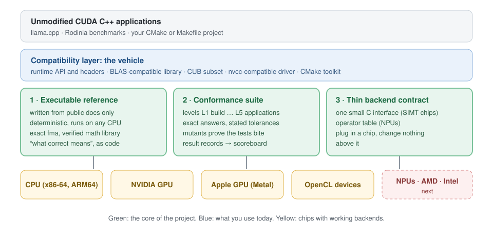
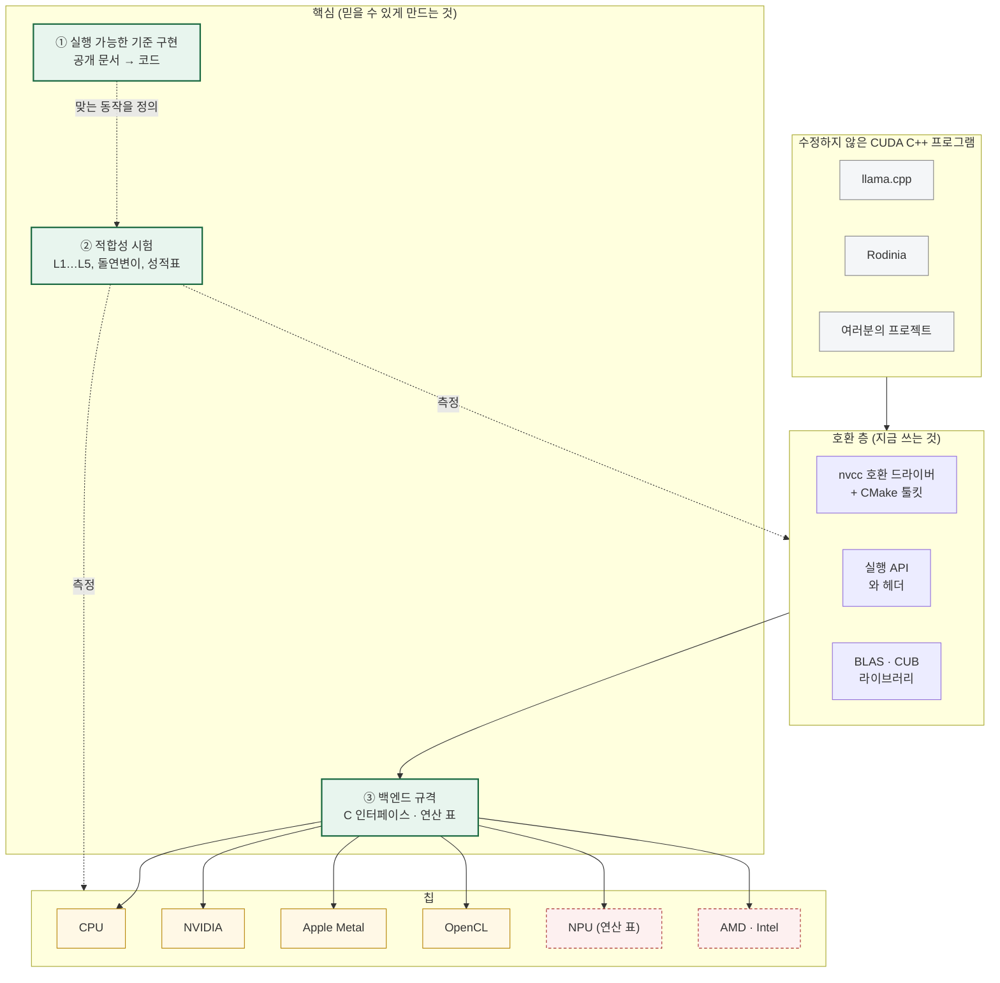
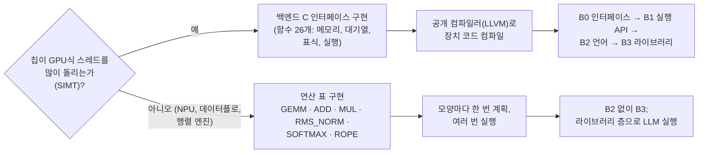
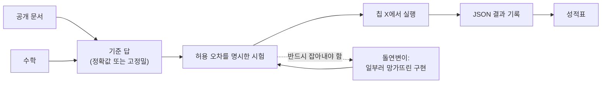
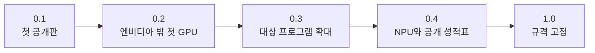

<div align="center">

# OpenCuda

**고치지 않은 CUDA C++ 소스를 어떤 칩에서든 돌리고, 얼마나 제대로 도는지 잰다.**

공개 기준 구현, 공개 적합성 시험, 그리고 어떤 칩이든 꽂을 수 있는 얇은 규격.

[English](README.md) · [인터랙티브 개요](docs/site/index.html) · [구조](ARCHITECTURE.ko.md) · [칩 추가하기](docs/public/BACKEND_GUIDE.ko.md) · [자주 묻는 질문](docs/FAQ.ko.md)



</div>

> OpenCuda는 독립 오픈소스 프로젝트다. 코드에서는 짧은 접두어 `ocu`를 쓴다.
> CUDA는 NVIDIA Corporation의 상표다. 이 프로젝트는 NVIDIA와 관계가 없고 NVIDIA의 보증도 받지 않았다.
> "CUDA C++"과 "CUDA Runtime API"라는 말은 이 소프트웨어가 무엇을 받는지 설명하는 데만 쓴다.
> 헤더와 구현은 모두 공개 문서만 보고 새로 작성했다.

---

## 한눈에 보기

| | |
|---|---|
| **실제 프로그램** | llama.cpp(CUDA 소스 약 150개)를 **수정 없이** 빌드한다. 연산 시험은 CPU 경로와 GPU 경로 모두 **15,894 / 15,894** 통과. |
| **라이브러리** | BLAS 호환 라이브러리 **1,395 / 1,395** · CUB 부분집합 독립 확인 **5,500건** 통과 · 칩 중립 C++ 커널로 fp32 GEMM **14.0 TFLOP/s** |
| **칩** | CPU(x86-64, ARM64) · NVIDIA GPU · Apple GPU(Metal) · OpenCL · NPU 시뮬레이터 |
| **운영체제** | Linux 231 / 231 · Windows 151 / 151(교차 빌드, Wine) · macOS 124 / 124(M3, M1 Pro) · Windows 10 노트북 37 / 38(1개 건너뜀) |
| **상태** | 정식 출시 전(0.x). 아직 지원하지 않는 것은 [자주 묻는 질문](docs/FAQ.ko.md)에 있다. |
| **클린룸** | 공개 문서만 보고 작성. 칩 회사의 헤더·SDK 파일·소스·바이너리는 보지 않음 |

---

## 왜 이 프로젝트가 필요한가

GPU 소프트웨어의 대부분은 CUDA C++로 쓰여 있다. 이를 다른 하드웨어에서 돌리려면
다시 쓰거나, 번역기를 거치거나, 호환 층을 쓴다. 어느 방법을 쓰든 같은 질문이 남는다.

> **그 프로그램은 여전히 같은 동작을 하는가? 그리고 그걸 누가, 어떻게 아는가?**

이 질문에 대한 공개되고 실행 가능한 답은 아직 없다. 지금은 한 회사의 구현이
사실상 "CUDA 동작"의 정의 역할을 한다. 그 결과 다른 칩 회사와 이식 도구는 모두
짐작에 기대고, 사용자는 들은 말을 직접 확인할 방법이 없다.

### 사명

**CUDA 호환을 주장이 아니라 공개적으로 측정되는 성질로 만든다.** 크든 작든 모든
칩에, 세상이 이미 써 둔 소프트웨어를 돌릴 같은 공개된 길을 준다.

### 목표

| 목표 | 이룬 것을 어떻게 아는가 |
|---|---|
| 문서화된 CUDA 동작의 완전하고 실행 가능한 정의 | 문서에 있는 모든 실행 API와 언어 기능에 기준 구현과 시험이 있다 |
| 누구나 돌릴 수 있는 중립적인 잣대 | 우리가 만들지 않은 구현까지 공개 성적표에 결과 기록을 제출한다 |
| 새 칩을 위한 짧은 길 | 새 GPU 백엔드가 몇 주 안에 B1 단계에 이르고, NPU가 연산 몇 개로 LLM을 돌린다 |
| 수정 없이 도는 실제 소프트웨어 | 널리 쓰이는 프로그램이 엔비디아가 아닌 여러 칩에서 빌드되고 자체 시험을 통과한다 |

---

## 한 장으로 보는 구조



| 부분 | 무엇 | 왜 중요한가 |
|---|---|---|
| **① 실행 가능한 기준 구현** | 실행 API, 언어 내장 기능, 수학 라이브러리를 공개 문서만으로 구현했다. 보통의 CPU에서 결정적으로 돈다. | 어떤 칩이든, 다른 어떤 호환 도구든 같은 답과 비교할 수 있다. 문서가 요구하는 곳은 비트 단위로 비교한다. |
| **② 적합성 시험** | "컴파일되는가"부터 "실제 프로그램이 같은 답을 내는가"까지 시험한다. 시험마다 정확한 답이나 명시한 허용 오차가 있다. | "호환된다"가 숫자가 된다. 일부러 망가뜨린 구현을 잡아내는 것으로 시험 스스로 제 몫을 증명한다. |
| **③ 얇은 백엔드 규격** | GPU식 스레드를 쓰는 칩을 위한 C 인터페이스 하나(함수 26개), 그렇지 않은 가속기를 위한 연산 표 | 새 칩을 지원하려면 이 규격만 구현하면 된다 |

**호환 층**은 ①~③이 실제 소프트웨어에서 통한다는 것을 보여 주는 수단이다.
목적지가 아니라 운반 수단이다.

---

## 어디에 서 있는가

CUDA 소프트웨어를 다른 곳에서 돌리는 방법은 여럿이다. 각 방법은 서로 다른 질문에
답하며, 그중 상당수는 같은 시험으로 잴 수 있다.

| 접근 | 대표 예 | 입력 | 공개 | 정확성을 재는 장치 |
|---|---|---|---|---|
| 소스 이식 도구 | HIPIFY, SYCLomatic | CUDA 소스(한 번 고쳐 씀) | 예 | 없음, 결과는 직접 시험 |
| 이식형 언어 | SYCL, OpenCL, Triton | 새로 쓴 코드 | 예 | 언어마다 다름 |
| 바이너리 수준 호환 | ZLUDA | 컴파일된 CUDA 프로그램 | 예 | 없음 |
| 다른 GPU용 소스 컴파일러 | chipStar, 상용 컴파일러 | 수정하지 않은 CUDA 소스 | 제각각 | 공개 시험 없음 |
| **OpenCuda** | | **수정하지 않은 CUDA 소스** | **예** | **있음: 기준 구현과 시험 자체가 산출물** |

다른 점:

1. **정의가 공개되어 있고 실행된다.** 다른 프로젝트는 호환을 구현한다.
   OpenCuda는 호환을 누구나 돌릴 수 있는 형태로 정의하고, 스스로를 그 정의로 검증한다.
2. **구조적으로 중립이다.** 어느 칩도 특별 대우하지 않는다. NVIDIA 백엔드도 여러
   백엔드 중 하나이고, 정답의 원천이 아니라 대조용으로 쓴다.
3. **스레드가 없는 가속기도 정식 대상이다.** 연산 표는 NPU를 GPU인 척하게 하지 않고
   들어올 길을 준다.
4. **정직하게 실패한다.** 지원하지 않는 기능은 "지원 안 함"을 돌려준다. 결과는 표본
   출력, 중앙값, 느린 10% 구간과 함께 보고한다.

---

## 지금까지의 결과

시험 기기:

- **Linux:** x86-64(WSL2), NVIDIA RTX 5070 Ti.
- **Apple:** Apple M3, Apple M1 Pro.
- **Windows:** Windows 10 노트북.

속도는 **중앙값 / 느린 10%** 로 적는다.

### llama.cpp, 소스 수정 없이

| 확인 항목 | CPU 경로 | NVIDIA GPU 경로 |
|---|---|---|
| 수정 없이 빌드(CUDA 소스 약 150개, 기본 설정) | ✅ | ✅ |
| `test-backend-ops`: 모든 연산을 llama.cpp 자체 CPU 백엔드와 비교 | **15,894 / 15,894** | **15,894 / 15,894** |
| 생성, 0.5B 파라미터 모델 Q8_0(토큰/초) | 1.25 / 1.08 | 95.5 / 93.3 |
| 프롬프트 처리(토큰/초) | 39.3 / 38.2 | 1,373 / 1,350 |

표본 출력(프롬프트 *"The city of Paris"*, 탐욕 디코딩):

```
기준 (llama.cpp 자체 CPU 백엔드):
  The city of Paris has a rich history that dates back to the 6th century.
  The city was founded by the Romans and was named after ...
우리 CPU 경로:
  The city of Paris has a rich history that dates back to the 6th century.
  The city was founded by the Romans, who built a city on the site of ...
```

두 출력은 20단어쯤에서 갈라진다.

- **우리 CPU 경로와 GPU 경로끼리:** 64토큰 중 63개가 같다.
- **우리 경로와 기준 사이:** 64개 중 47~48개가 같다.

이 차이는 결함이 아니라 부동소수점 계산 순서 때문이다. 모든 빌드에 같은 토큰을 넣고
같은 가중치를 float32로 푼 기준 답과 비교하면, 우리 경로는 llama.cpp 자체 CPU 백엔드만큼
기준 답에 가깝다. 프롬프트를 한 번에 처리할 때는 훨씬 더 가깝다(KL 평균: 우리 5e-8~6e-7,
기준 3.7e-4~3.0e-3). 1등 토큰이 바뀌는 곳은 거의 동점인 위치뿐이다. 기준 답의 1·2등 차이가
0.5 이상인 위치에서는 모든 빌드가 같은 토큰을 고른다. 그래서 탐욕 생성 일치율은 좋은 지표가
아니며, 시험의 실제 프로그램 단계는 기준 답 대비 KL 거리로 잰다
([분석](docs/llama-cpp-logit-agreement.md)).

### 라이브러리와 수학

| 영역 | 결과 |
|---|---|
| BLAS 호환 라이브러리(`cublas_v2.h`) | CPU와 GPU에서 사례 1,395 / 1,395. RTX 5070 Ti, n = 4096에서 텐서 코어 없이 fp32 14.0 TFLOP/s, fp16 17.3 TFLOP/s. |
| CUB 부분집합: 리덕션, 스캔, 기수·구간 정렬, 블록 기본 연산 | CPU와 GPU에서 독립 확인 5,500건 통과 |
| 장치 수학 라이브러리 | 처음부터 새로 작성했다. fma와 fmaf는 C 라이브러리가 부정확한 호스트를 포함해 모든 호스트에서 정확하다. 예: powf 최대 0.75 ulp, erff 최대 0.76 ulp. |

### 백엔드

| 백엔드 | 상태 | 근거 |
|---|---|---|
| **CPU**(x86-64, ARM64) | 기준 구현 | GPU 스레드를 결정적 순서 또는 무작위 순서의 파이버로 돌린다. 워프 폭은 32 또는 64. |
| **NVIDIA GPU** | 동작 | 드라이버의 공개 API를 실행할 때 불러오므로 빌드에 칩 회사 파일이 필요 없다. PTX는 오픈소스 컴파일러가 만든다. |
| **Apple GPU(Metal)** | 1차 구현 | M3와 M1 Pro에서 백엔드 시험 53 / 53. CUDA → Metal Shading Language 번역기가 Rodinia 커널 79개 중 49개를 처리한다. |
| **OpenCL** | PoCL에서 동작 | 시험 103 / 103. Rodinia 17개 빌드, 14개 일치. 커널은 SPIR-V를 거친다. |
| **NPU 시뮬레이터** | 설계 목표 | 커널 실행 없음, 호스트가 만질 수 없는 장치 메모리, 스크래치패드 제한, DMA 전송량 집계 |
| AMD·Intel GPU | 장치 코드 컴파일 됨 | 실행 백엔드는 아직 없음 |

### 벤치마크와 플랫폼

| 확인 항목 | 결과 |
|---|---|
| Rodinia(CUDA 프로그램 18개, 수정 없이) | 17개 빌드. 14개가 독립 기준(OpenMP판, 직렬 기준, 프로그램 자체 검사)과 일치. 선택 옵션인 PTX 시프트 의미를 켜면 15개. |
| Linux · Wine에서 돈 Windows | 231 / 231 · 151 / 151 |
| Windows 10 노트북 · macOS M3·M1 Pro | 37 / 38(1개 건너뜀) · 기기마다 124 / 124 |

---

## 칩 회사를 위해: 함께하는 길과 우리가 배운 것

이 프로젝트는 **함께 쓰는 도구이자 함께 배우는 학교**가 되려 한다. 그 과정에서 배운
것을 모두 공개해서, 크든 작든 모든 칩 팀이 같은 지식에서 출발하게 한다.

### 들어오는 두 갈래 길



| 단계 | 보여 주는 것 |
|---|---|
| **B0 인터페이스** | 백엔드 시험 통과: 메모리, 대기열, 표식, 실행, 오류 경우 |
| **B1 실행 API** | 보통의 CUDA C++ 시험 프로그램이 수정 없이 빌드되고 통과 |
| **B2 언어** | 장치 코드 의미: 장벽, 공유 메모리, 원자 연산, 워프 연산, 허용 오차 안의 수학 |
| **B3 라이브러리** | BLAS·연산 표 같은 라이브러리 수준 시험이 허용 오차 안 |

### 실제 소프트웨어를 돌리며 배운 열 가지

시간이 가장 많이 든 곳들이다. 새 칩이나 새 도구 체인이 걸려 넘어지기 쉬운 함정이기도 하다.

| # | 교훈 | 우리가 본 것 |
|---|---|---|
| 1 | **API 개수를 채우는 건 쉬운 부분이다.** 실행 API 함수를 늘리는 건 빨랐다. 그 *의미*를 맞추는 데 대부분의 시간이 들었다. | 실행 API 80여 개는 며칠, 의미 맞추기는 몇 주 |
| 2 | **곱셈-덧셈 융합(fma)은 어디서나 정확해야 한다.** 호스트 C 라이브러리의 fma 하나가 부정확하면 그 위에 쌓은 모든 함수로 번진다. | 소프트웨어로 정확한 fma를 만들자 powf 오차 3.84 → 0.75 ulp |
| 3 | **두 번 반올림하는 것은 조용한 버그다.** 넓은 형으로 계산한 뒤 다시 반올림하면 드문 경우에 틀린 답이 나온다. | bf16 fma에서 틀린 결과 1,715건을 독립 시험이 찾아냄 |
| 4 | **부호 있는 0, NaN, 범위 밖 변환도 규격의 일부다.** | 반정밀도 max/min이 다른 0을 돌려줌, NaN → 정수 변환이 경로마다 달랐음 |
| 5 | **비트 폭 이상 미는 시프트는 언어마다 다르다.** | C++는 정의하지 않고 PTX는 정의한다. 벤치마크 하나가 PTX 의미에 기댄다. |
| 6 | **LLM에서는 연산 몇 개가 시간을 거의 다 쓴다.** | 행렬곱 86~95%, 상위 5개 연산 묶음 98~100%, 텐서 모양 9~17개뿐 |
| 7 | **모양이 고정된다는 것은 기회다.** 모양이 몇 개뿐이라 "한 번 계획, 여러 번 실행"이 미리 컴파일하는 도구 체인을 가진 가속기에 잘 맞는다. | 연산 표의 계획 / 실행 분리 |
| 8 | **GPU 코드에서 스레드 하나의 일은 아주 작다.** GPU가 아닌 대상에서는 스레드마다 드는 부가 비용이 전체를 지배한다. | llama.cpp 행렬-벡터 커널에서 스레드당 곱셈 약 7번, 파이버 전환 비용은 60 ns |
| 9 | **도구 체인이 제품의 절반이다.** 빌드 시스템은 컴파일러를 `--version` 출력으로 알아본다. 링커마다 옵션 형식이 다르고, 플랫폼마다 기본 언어 표준이 다르다. | 커널이 돌기도 전에 CMake, Apple 링커, C++98 기본값이 실제 기기에서 차례로 빌드를 깼다 |
| 10 | **시험은 구현한 사람이 아닌 다른 사람이 써야 하고, 실패할 수 있음을 증명해야 한다.** | 독립 시험이 실제 결함을 찾았다. 일부러 망가뜨린 구현은 반드시 잡혀야 한다. |

### 함께 나누는 지식

- **규격:** 백엔드 인터페이스(`backends/interface/ocu_backend.h`)와 연산 표
  ([`docs/spec/op-table.ko.md`](docs/spec/op-table.ko.md)). 연산 표에는 EXACT, ULP, ROW,
  DOT의 허용 오차 등급이 있다.
- **기능 카드**(`cards/`): 기능마다 범위, 참고한 공개 자료, 시험, 열린 질문을 적었다.
  같은 기능을 구현하는 사람에게 읽기 목록 역할을 한다.
- **작업 부하 분석:** 실제 LLM 추론이 어디에 시간을 쓰는지 연산별·모양별로 나눴다.
- **중립 기준:** 여러분의 구현과 우리 구현을 나란히 돌려 비교할 수 있다. 문서가 요구하는
  곳은 비트 단위로 비교한다.

---

## 적합성을 재는 방법



| 단계 | 질문 |
|---|---|
| L1 빌드 | 소스가 수정 없이 컴파일되는가? |
| L2 실행 API | 각 API 호출이 문서대로 동작하는가? |
| L3 언어 | 장치 코드의 의미(산술, 원자 연산, 워프, 동기화)가 맞는가? |
| L4 라이브러리 | 수치 결과가 정확한 기준 대비 허용 오차 안에 드는가? |
| L5 실제 프로그램 | 실제 프로그램이 독립 기준과 같은 결과를 내는가? |

규칙:

- **정확성.** 정수와 제어 흐름은 정확히 같아야 한다. 부동소수점은 연산별 허용 오차 안에
  들어야 한다. NaN과 무한대는 위치까지 같아야 한다.
- **기준 답의 출처.** 먼저 문서, 다음으로 고정밀로 계산한 수학 결과다. 검토를 거친 관찰은
  둘 다 정하지 못하는 곳에서만 쓴다.
- **속도.** 중앙값과 느린 10%로 보고한다. 평균만 내지 않는다.

---

## 빠른 시작

필요한 것: CMake 3.20 이상, C11/C++17 컴파일러, Python 3.9 이상, 컴파일러 경로를
쓰려면 LLVM Clang.

```sh
cmake -S . -B build
cmake --build build -j4
ctest --test-dir build --output-on-failure
```

실행 시 백엔드는 `OCU_BACKEND=cpu|nvidia|metal|opencl`로 고른다. 장치가 없는
시험은 실패가 아니라 건너뜀으로 처리된다.

**기존 CUDA 프로젝트 빌드.** 빌드 폴더 안의 툴킷 폴더에 `nvcc` 호환 드라이버, 헤더,
라이브러리가 들어 있다.

```sh
# NVCC 변수를 읽는 Makefile 프로젝트
make NVCC=build/toolkit/bin/ocu-nvcc

# CMake 프로젝트 (enable_language(CUDA), find_package(CUDAToolkit))
cmake -S your-project -B your-build \
      -DCMAKE_TOOLCHAIN_FILE=build/toolkit/cmake/OcuCUDA.cmake -DOCU_TARGET=cpu   # 또는 nvidia
cmake --build your-build
```

**다른 플랫폼.**

- **Windows:** CPU 경로를
  `-DCMAKE_TOOLCHAIN_FILE=cmake/toolchains/x86_64-w64-mingw32.cmake`로 MinGW-w64
  교차 빌드한 뒤, Windows나 Wine에서 실행한다. MSVC는 아직 지원하지 않는다.
- **macOS(Apple 실리콘):** Linux와 같은 명령을 쓴다. Metal 백엔드가 기본으로 켜진다.

---

## 저장소 구성

| 폴더 | 내용 |
|---|---|
| `backends/` | 백엔드 규격(`interface/`), CPU, NVIDIA, Metal, OpenCL, NPU 시뮬레이터, 기준 연산 |
| `runtime/` | 실행 API, 헤더, 장치 수학 라이브러리 |
| `libs/` | BLAS 층과 BLAS 호환 라이브러리 |
| `compiler/` | `nvcc` 호환 드라이버, CPU 경로, Metal·OpenCL 번역기 |
| `conformance/` | 기준 답, 허용 오차, 채점기, 돌연변이, 외부 프로그램 |
| `tests/` · `tuning/` | 시험 · 보고 규칙을 지키는 측정기 |
| `cards/` · `docs/` | 기능별 카드 · 규격과 설계 문서 |

---

## 로드맵



1. **엔비디아가 아닌 실제 하드웨어에서 낸 결과.** Apple GPU, AMD·Intel GPU, 연산 표를
   통한 NPU에서 llama.cpp를 돌리고, 각 칩 고유 백엔드와 비교한다.
2. **대상 프로그램 확대.** 빌드율을 볼 수백 개 벤치마크 프로그램, 역전파가 있는 학습 코드,
   Thrust·CUB를 많이 쓰는 라이브러리, 고전 HPC 모음을 더해 한 프로그램에 맞춰지지 않게 한다.
3. **"같은 답"을 시험 단계로.** llama.cpp에 쓴 KL 기반 비교를 L5 단계에 넣는다. 기준선은 한
   프로그램의 공식 백엔드들이 서로 얼마나 다른지로 정한다.
4. **칩 고유 소프트웨어와 나란히 잰 성능.** 모든 칩 결과를 그 칩의 자체 백엔드 결과와 함께
   공개한다. CPU 기준 경로는 행렬 연산을 빠른 라이브러리로 보내고, 동기화 없는 구간을 벡터
   반복문으로 컴파일해 빠르게 한다.
5. **프로그램이 이끄는 라이브러리 확장.** cuBLASLt식 행렬곱, CUB 부분집합 위의 Thrust, 그다음
   FFT·난수. PyTorch 수준의 라이브러리(cuDNN, NCCL)는 장기 목표다.
6. **과정 공개.** 공개 CI, 버전을 매긴 출시, MSVC 직접 빌드, 다른 구현의 결과도 받는 성적표.

이정표와 완료 기준은 [docs/public/ROADMAP.ko.md](docs/public/ROADMAP.ko.md)에 있다. 날짜는 약속하지 않는다.

## 자주 묻는 질문

자주 받는 질문에 짧게 답한다. 전체 목록은 [docs/FAQ.ko.md](docs/FAQ.ko.md)에 있다.

| 질문 | 짧은 답 |
|---|---|
| HIPIFY, SYCLomatic, ZLUDA, chipStar와 무엇이 다른가? | 그 도구들은 코드를 한 스택으로 옮긴다. OpenCuda는 그 도구들까지 잴 수 있는 기준 구현과 적합성 시험을 공개하고, 연산 표로 NPU도 지원한다. |
| 왜 PyTorch나 Triton이 아니라 CUDA C++인가? | 프레임워크 아래에는 여전히 CUDA C++ 엔진·커널·라이브러리가 있다. 새 칩은 이 층부터 받아들여야 하며, OpenCuda는 프레임워크 백엔드를 보완한다. |
| NVIDIA에 맞춰 튜닝한 코드가 다른 칩에서도 빠른가? | 저절로 빨라지지는 않는다. 정확성이 먼저이고, 속도는 칩 고유 소프트웨어와 나란히 재서 그대로 공개한다. |
| 부동소수점에서 "맞다"는 어떻게 정하나? | 공개 문서, 다음으로 고정밀 수학. 실제 프로그램은 고정밀 기준 답과 KL 거리로 비교하고, 그 프로그램의 공식 백엔드들끼리의 차이를 허용 폭으로 삼는다. |
| 아직 지원하지 않는 것은? | CUDA 그래프, 텍스처·서피스, cuBLASLt 행렬곱, cuDNN·cuFFT·cuRAND·cuSPARSE·NCCL, Thrust, MSVC 직접 빌드. 모두 조용히 틀리지 않고 "지원 안 함"을 돌려준다. |
| llama.cpp에만 맞춘 것 아닌가? | 지금까지는 그 비중이 크다. 다음 대상으로 수백 개 벤치마크 프로그램, 학습 코드, Thrust·CUB를 많이 쓰는 라이브러리, 고전 HPC 모음을 더한다. |
| 실제 서비스에 써도 되나? | 아직 아니다. 정식 출시 전(0.x)이고, 백엔드 ABI에는 버전을 매긴다. |

## 기여

[CONTRIBUTING.ko.md](CONTRIBUTING.ko.md)와 [ALLOWLIST.ko.md](ALLOWLIST.ko.md)를 먼저 읽는다.
클린룸 규칙은 엄격하다. 공개 문서만 보고, 칩 회사의 헤더·SDK 파일·소스·바이너리는
절대 보지 않는다. 운영 방식은 [docs/public/GOVERNANCE.ko.md](docs/public/GOVERNANCE.ko.md)에 있다.

## 라이선스

Apache License 2.0. [LICENSE](LICENSE)와 [NOTICE](NOTICE)를 본다.

Apache-2.0에는 특허 사용 허가와 특허 소송 시 허가가 끝나는 조항이 명시되어 있어, 칩 회사와 그 법무팀이
잘 알려진 조건으로 도입하고 기여할 수 있다.
