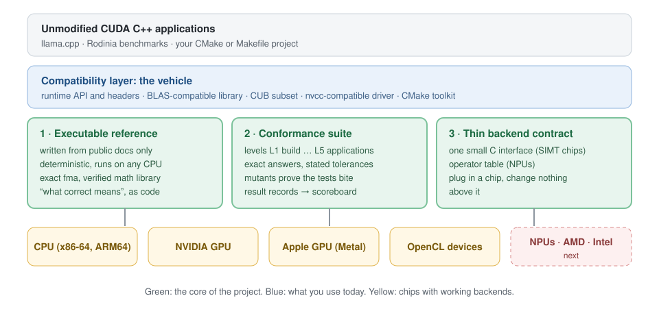
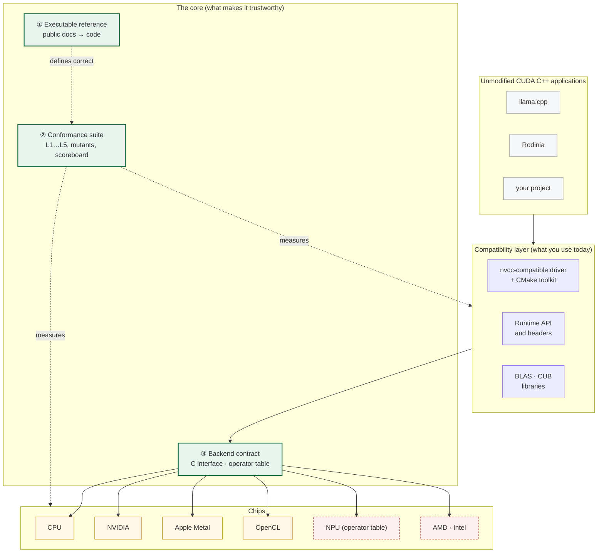
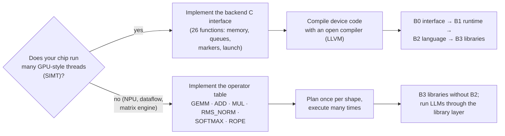
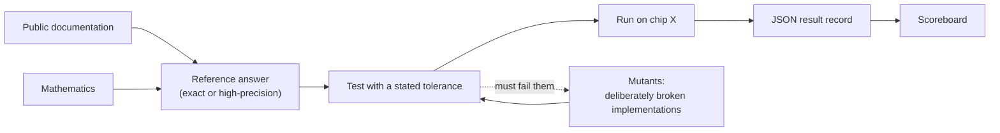

<div align="center">

# OpenCuda

**Run unmodified CUDA C++ source on any chip, and measure how well it really works.**

An open reference, an open conformance suite, and a thin contract that any chip can plug into.

[한국어](README.ko.md) · [Interactive overview](docs/site/index.html) · [Architecture](ARCHITECTURE.md) · [Add a chip](docs/public/BACKEND_GUIDE.md) · [FAQ](docs/FAQ.md)



</div>

> OpenCuda is an independent open-source project. In code, it uses the short prefix `ocu`.
> CUDA is a trademark of NVIDIA Corporation. This project is not affiliated with or endorsed by NVIDIA.
> "CUDA C++" and "CUDA Runtime API" appear here only to say what the software accepts.
> Every header and every line of the implementation was written from publicly available documentation.

---

## At a glance

| | |
|---|---|
| **Real application** | llama.cpp (about 150 CUDA source files) builds **unmodified**. Its operator test passes **15,894 / 15,894** on the CPU path and on the GPU path. |
| **Libraries** | BLAS-compatible library **1,395 / 1,395**; CUB subset **5,500** independent checks; fp32 GEMM **14.0 TFLOP/s** with portable C++ kernels |
| **Chips** | CPU (x86-64, ARM64) · NVIDIA GPU · Apple GPU (Metal) · OpenCL · NPU simulator |
| **Operating systems** | Linux 232 / 232 · Windows 152 / 152 (cross-built, Wine) · macOS 124 / 124 (M3, M1 Pro) · Windows 10 laptop 37 / 38 (1 skipped) |
| **Status** | Pre-release (0.x). See the [FAQ](docs/FAQ.md) for what is not supported yet. |
| **Clean room** | public documentation only; no vendor headers, SDK files, sources or binaries |

---

## Why this project exists

GPU software is mostly written in CUDA C++. To run it on other hardware,
people rewrite it, run it through a translator, or use a compatibility
layer. In every case the same question is left open:

> **Does the program still behave the same way, and how would anyone know?**

Nobody has a public, executable answer to that question. Today the closest
thing to a definition of "CUDA behaviour" is one vendor's implementation.
That leaves every other chip maker and every portability tool to guess, and
leaves users without a way to check what they are told.

### Mission

**Make CUDA-compatibility a public, measurable property instead of a claim.**
Give every chip, large or small, the same open path to run the software the
world has already written.

### Goals

| Goal | How we will know it is reached |
|---|---|
| A complete, executable definition of documented CUDA behaviour | every documented runtime call and language feature has a reference implementation and a test |
| A neutral yardstick anyone can run | other implementations, including ones we did not write, submit result records to a public scoreboard |
| A short path for new chips | a new GPU backend reaches level B1 in weeks, and an NPU runs an LLM through a handful of operators |
| Real software, unmodified | widely used applications build and pass their own tests on several non-NVIDIA chips |

---

## The idea in one picture



| Part | What it is | Why it matters |
|---|---|---|
| **① Executable reference** | The runtime, the language built-ins and the math library, written only from public documentation. It runs deterministically on an ordinary CPU. | Any chip, and any other compatibility tool, can compare against the same answers, bit for bit where the documentation requires it. |
| **② Conformance suite** | Tests from "does it compile" up to "does a real program give the same answer". Each test has an exact answer or a stated tolerance. | "Compatible" becomes a number. The suite proves it works by catching deliberately broken implementations. |
| **③ Thin backend contract** | One C interface (26 functions) for chips with GPU-style threads, and an operator table for accelerators without them | Supporting a new chip means implementing the contract and nothing else |

The **compatibility layer** is how we show that ①–③ hold up on real
software. It is the vehicle, not the destination.

---

## Where it sits

There are several ways to run CUDA software elsewhere. They answer different
questions, and many of them can be measured by the same suite.

| Approach | Typical examples | Input | Open | Built-in measure of correctness |
|---|---|---|---|---|
| Source migration tools | HIPIFY, SYCLomatic | CUDA source, rewritten once | yes | no; you test the result yourself |
| Portable languages | SYCL, OpenCL, Triton | new code | yes | per language |
| Binary-level compatibility | ZLUDA | compiled CUDA programs | yes | no |
| Source compilers for other GPUs | chipStar and commercial compilers | unmodified CUDA source | varies | no public suite |
| **OpenCuda** | | **unmodified CUDA source** | **yes** | **yes: the reference and the suite are the product** |

What is different here:

1. **The definition is open and executable.** Others implement compatibility.
   This project also defines it in a form anyone can run, and checks itself
   against it.
2. **Neutral by construction.** No chip is privileged. The NVIDIA backend is
   one backend among several and is used as a check, not as the source of truth.
3. **Accelerators without threads are first-class.** The operator table gives
   NPUs a way in that does not pretend they are GPUs.
4. **Honest failure.** Unsupported features return "not supported". Results
   are reported with sample outputs and with medians and slow-10 % values.

---

## Results so far

Machines used:

- **Linux:** x86-64 under WSL2, with an NVIDIA RTX 5070 Ti.
- **Apple:** Apple M3 and Apple M1 Pro.
- **Windows:** a Windows 10 laptop.

Speed is given as **median / slow 10 %**.

### llama.cpp, unmodified

| Check | CPU path | NVIDIA GPU path |
|---|---|---|
| Builds unmodified (about 150 CUDA sources, default settings) | ✅ | ✅ |
| `test-backend-ops`: every operator compared with llama.cpp's own CPU backend | **15,894 / 15,894** | **15,894 / 15,894** |
| Generation, 0.5B-parameter model, Q8_0 (tokens/s) | 1.25 / 1.08 | 95.5 / 93.3 |
| Prompt processing (tokens/s) | 39.3 / 38.2 | 1,373 / 1,350 |

Sample output, prompt *"The city of Paris"*, greedy decoding:

```
reference (llama.cpp's own CPU backend):
  The city of Paris has a rich history that dates back to the 6th century.
  The city was founded by the Romans and was named after ...
our CPU path:
  The city of Paris has a rich history that dates back to the 6th century.
  The city was founded by the Romans, who built a city on the site of ...
```

The two outputs drift apart after about 20 words:

- **Our CPU path vs. our GPU path:** 63 of 64 tokens agree.
- **Our paths vs. the reference:** 47–48 of 64 tokens agree (explained below).

This is floating-point ordering, not a defect. With the same tokens fed to
every build and compared against a float32 oracle (same weights,
dequantised), our paths stay as close to the oracle as llama.cpp's own CPU
backend, and much closer when the prompt is processed in one batch
(mean KL 5e-8 to 6e-7 for ours, 3.7e-4 to 3.0e-3 for the reference).
Top-token changes happen only at near-ties: wherever the oracle's top two
logits differ by 0.5 or more, every build agrees. Greedy token matching is
therefore not a useful metric. The suite's application level uses KL
divergence against the oracle instead
([study](docs/llama-cpp-logit-agreement.md)).

### Libraries and math

| Area | Result |
|---|---|
| BLAS-compatible library (`cublas_v2.h`) | 1,395 / 1,395 cases on CPU and GPU. On the RTX 5070 Ti at n = 4096: fp32 14.0 TFLOP/s, fp16 17.3 TFLOP/s, without tensor cores. |
| CUB subset: reductions, scans, radix and segmented sorts, block primitives | 5,500 independent checks pass on CPU and GPU |
| Device math library | Written from scratch. fma and fmaf are exact on every host, including hosts whose C library is not. Examples: powf at most 0.75 ulp, erff at most 0.76 ulp. |

### Backends

| Backend | State | Evidence |
|---|---|---|
| **CPU** (x86-64, ARM64) | reference | GPU threads run as fibers in deterministic or randomised order; warps of 32 or 64 lanes |
| **NVIDIA GPU** | working | Uses the driver's public API, loaded when the program runs, so no vendor files are needed to build. PTX comes from an open-source compiler. |
| **Apple GPU (Metal)** | first cut | Backend tests 53 / 53 on M3 and M1 Pro. The CUDA → Metal Shading Language translator handles 49 of 79 Rodinia kernels. |
| **OpenCL** | working on PoCL | 103 / 103 tests. Rodinia: 17 build, 14 match. Kernels go through SPIR-V. |
| **NPU simulator** | design target | No kernel launches, device memory the host cannot touch, a scratchpad limit, counted DMA traffic |
| AMD, Intel GPUs | device code compiles | no runtime backend yet |

### Benchmarks and platforms

| Check | Result |
|---|---|
| Rodinia (18 CUDA programs, unmodified) | 17 build. 14 match an independent reference (OpenMP version, serial reference, or the program's own check). 15 match with the opt-in PTX shift semantics. |
| PolyBench-ACC (21 programs, unmodified) | 21 build and run; 20 pass the program's own CPU-vs-GPU check (the other has a race the CPU path exposes: [details](cards/apps/app-corpus.md)) |
| Parboil (11 programs, unmodified) | 8 build (3 need the texture API); 5 checked, all match the suite's CPU version exactly |
| llm.c GPT-2 training (fp32, unmodified) | builds and trains; losses match the reference C trainer to 6 digits once a race in the loss read is ordered |
| Linux · Windows under Wine | 232 / 232 · 152 / 152 |
| Windows 10 laptop · macOS M3 and M1 Pro | 37 / 38 (1 skipped) · 124 / 124 on each |

---

## For chip makers: how to join, and what we learned

This project is meant to be **a shared school as much as a shared tool**. We
publish everything we learned along the way, so that every chip team, large
or small, starts from the same knowledge.

### Two ways in



| Level | What it shows |
|---|---|
| **B0 interface** | Backend tests pass: memory, queues, markers, launch, error cases |
| **B1 runtime** | Ordinary CUDA C++ test programs build unmodified and pass |
| **B2 language** | Device-code semantics: barriers, shared memory, atomics, warp operations, math within tolerance |
| **B3 libraries** | Library-level suites within tolerance, such as BLAS and the operator table |

### Ten lessons from making real software run

These are the things that cost the most time. Each one is a trap a new chip
or toolchain is likely to hit.

| # | Lesson | What we saw |
|---|---|---|
| 1 | **Breadth of the API is the easy part.** Adding runtime functions was fast. Matching their *meaning* took most of the time. | 80+ runtime functions in days; weeks of work on semantics |
| 2 | **Fused multiply-add must be exact, everywhere.** One inexact `fma` in a host C library spreads into every function built on it. | powf error 3.84 → 0.75 ulp once fma was made exact in software |
| 3 | **Rounding twice is a silent bug.** Computing in a wider type and then rounding again gives wrong answers in rare cases. | bf16 fma: 1,715 wrong results found by an independent test |
| 4 | **Signed zero, NaN and out-of-range conversions are part of the contract.** | half-precision max/min returned the wrong zero; NaN → int differed by path |
| 5 | **Shift counts at or above the bit width differ between languages.** | C++ leaves them undefined; PTX defines them. One benchmark depends on the PTX meaning. |
| 6 | **For LLMs, a few operators carry almost all the time.** | Matrix multiplication 86–95 %; the top 5 operator groups 98–100 %; only 9–17 tensor shapes |
| 7 | **Fixed shapes are an opportunity.** With so few shapes, plan-once / run-many execution suits accelerators with compile-ahead toolchains. | the operator table's plan / execute split |
| 8 | **Per-thread work in GPU code is tiny.** Any per-thread overhead on a non-GPU target dominates. | about 7 multiplies per thread in llama.cpp's matrix-vector kernel; fiber switch cost was 60 ns |
| 9 | **The toolchain is half the product.** Build systems identify compilers by their `--version` text. Linkers differ in option forms. Default language standards differ by platform. | CMake, Apple linker and C++98 defaults each broke the build on real machines before any kernel ran |
| 10 | **Tests must be written by someone other than the implementer, and must prove they can fail.** | independent tests found real defects; deliberately broken implementations must be caught |

### Knowledge we share

- **Specifications:** the backend interface (`backends/interface/ocu_backend.h`)
  and the operator table ([`docs/spec/op-table.md`](docs/spec/op-table.md)),
  with tolerance classes EXACT, ULP, ROW and DOT.
- **Feature cards** (`cards/`): for each feature, its scope, the public
  sources used, its tests and its open questions. They work as a reading
  list for anyone implementing the same feature.
- **Workload analysis:** where real LLM inference spends its time, broken
  down by operator and by shape.
- **A neutral reference:** run your implementation and ours side by side and
  compare, bit for bit where the documentation requires it.

---

## How conformance is measured



| Level | Question |
|---|---|
| L1 build | Does the source compile unmodified? |
| L2 runtime | Does each API call behave as documented? |
| L3 language | Do device-code semantics match: arithmetic, atomics, warps, synchronisation? |
| L4 libraries | Are numerical results within the stated tolerance of an exact reference? |
| L5 applications | Does a real program give the same result as an independent reference? |

Rules:

- **Exactness.** Integers and control flow must match exactly.
  Floating-point results must fall within a per-operation tolerance. NaN and
  infinity must match position by position.
- **Where reference answers come from.** Documented behaviour first, then
  mathematics computed in high precision. Reviewed observations are used
  only where neither decides.
- **Speed.** Reported as median and slow-10 %, never as a mean alone.

---

## Quick start

Requirements: CMake 3.20 or newer, a C11/C++17 compiler, Python 3.9 or
newer, and LLVM Clang for the compiler paths.

```sh
cmake -S . -B build
cmake --build build -j4
ctest --test-dir build --output-on-failure
```

Choose a backend at run time with `OCU_BACKEND=cpu|nvidia|metal|opencl`.
Tests that need a missing device are skipped, not failed.

**Build an existing CUDA project.** The build tree contains a toolkit folder
with an `nvcc`-compatible driver, the headers and the libraries.

```sh
# Makefile projects that read NVCC
make NVCC=build/toolkit/bin/ocu-nvcc

# CMake projects (enable_language(CUDA), find_package(CUDAToolkit))
cmake -S your-project -B your-build \
      -DCMAKE_TOOLCHAIN_FILE=build/toolkit/cmake/OcuCUDA.cmake -DOCU_TARGET=cpu   # or nvidia
cmake --build your-build
```

**Other platforms.**

- **Windows:** cross-build the CPU path with MinGW-w64 using
  `-DCMAKE_TOOLCHAIN_FILE=cmake/toolchains/x86_64-w64-mingw32.cmake`, then
  run on Windows or under Wine. MSVC is not supported yet.
- **macOS (Apple silicon):** the same commands as on Linux. The Metal
  backend is on by default.

---

## Repository layout

| Folder | Contents |
|---|---|
| `backends/` | the backend contract (`interface/`), CPU, NVIDIA, Metal, OpenCL, NPU simulator, reference operators |
| `runtime/` | runtime API, headers, device math library |
| `libs/` | BLAS layer and BLAS-compatible library |
| `compiler/` | `nvcc`-compatible driver, CPU path, Metal and OpenCL translators |
| `conformance/` | reference answers, tolerances, harness, mutants, external programs |
| `tests/` · `tuning/` | tests · benchmarks that follow the reporting rules |
| `cards/` · `docs/` | one card per feature · specifications and design notes |

---

## Roadmap


1. **Results on real non-NVIDIA hardware.** llama.cpp on Apple GPUs, AMD and
   Intel GPUs, and NPUs through the operator table, each compared with that
   chip's native backend.
2. **A broader application set.** Hundreds of benchmark programs for a build
   rate, a training code base (backward passes), a Thrust/CUB-heavy library
   and classic HPC suites, so the layer is not tuned to one program.
3. **"The same answer" as a suite level.** The KL-based comparison already
   used for llama.cpp becomes part of level L5, with thresholds set from how
   much an application's official backends differ from each other.
4. **Performance next to native software.** Every chip result is published
   beside that chip's own backend. The CPU reference path gets faster by
   sending matrix work to a fast library and compiling barrier-free regions
   as vector loops.
5. **Library coverage driven by applications.** cuBLASLt-style matmul, Thrust
   on top of the CUB subset, then FFT and random numbers. PyTorch-level
   libraries (cuDNN, NCCL) are a long-term goal.
6. **Opening the process.** Public CI, versioned releases, a native MSVC
   build, and a scoreboard that accepts results from other implementations.

Milestones and exit measures are in [docs/public/ROADMAP.md](docs/public/ROADMAP.md). No dates are promised.

## FAQ

Short answers to the questions we hear most. The full list is in [docs/FAQ.md](docs/FAQ.md).

| Question | Short answer |
|---|---|
| How is this different from HIPIFY, SYCLomatic, ZLUDA or chipStar? | They move code onto one stack. OpenCuda also publishes a reference and a conformance suite that can measure any of them, and supports NPUs through an operator table. |
| Why CUDA C++ and not PyTorch or Triton? | Frameworks still sit on CUDA C++ engines, kernels and libraries. New chips need that layer first; OpenCuda complements framework backends. |
| Will NVIDIA-tuned code be fast on other chips? | Not automatically. Correctness comes first; speed is measured against each chip's native software and published as it is. |
| How is "correct" defined for floating point? | Documented behaviour, then high-precision math. Applications are compared with a high-precision oracle by KL divergence, within the band that the app's own official backends show. |
| What is not supported yet? | CUDA graphs, textures and surfaces, cuBLASLt matmul, cuDNN, cuFFT, cuRAND, cuSPARSE, NCCL, Thrust, and native MSVC builds. Each returns "not supported" rather than failing silently. |
| Isn't it all about llama.cpp? | So far, mostly. Next targets add hundreds of benchmark programs, a training code base, a Thrust/CUB-heavy library and classic HPC suites. |
| Is it production-ready? | No. Pre-release (0.x); the backend ABI is versioned. |

## Contributing

Read [CONTRIBUTING.md](CONTRIBUTING.md) and [ALLOWLIST.md](ALLOWLIST.md)
first. The clean-room rule is strict: public documentation only, never
vendor headers, SDK files, sources or binaries. Governance is described in
[docs/public/GOVERNANCE.md](docs/public/GOVERNANCE.md).

## License

Apache License 2.0. See [LICENSE](LICENSE) and [NOTICE](NOTICE).

Apache-2.0 includes an explicit patent licence and patent-retaliation clause, so chip makers
and their legal teams can adopt and contribute with a well-understood set of terms.
