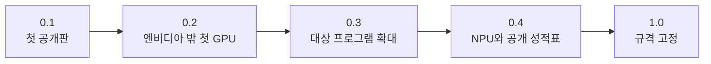

# 로드맵

[English](ROADMAP.md) · **한국어**

계획은 이정표 단위로 짠다. 이정표 안의 모든 완료 기준을 채우고, 그 결과를 표본 출력과 중앙값·느린 10% 속도와 함께 공개하면 그 이정표에 도달한 것으로 본다. **날짜는 약속하지 않는다.** 이정표에는 순서가 있지만, 앞 이정표에 기대지 않는 일은 먼저 시작할 수 있다.

## 지금 위치

지금까지 잰 것(자세한 내용은 [README.ko.md](../../README.ko.md)):

- llama.cpp(CUDA 소스 약 150개)가 수정 없이 빌드된다. 연산 시험은 CPU 경로와 NVIDIA GPU 경로 모두 15,894 / 15,894 통과한다.
- BLAS 호환 라이브러리는 CPU와 GPU에서 1,395 / 1,395 사례를 통과하고, CUB 부분집합은 독립 확인 5,500건을 통과한다.
- 백엔드:
  - CPU(기준 구현)와 NVIDIA GPU가 동작한다.
  - Apple GPU(Metal)는 1차 구현이다. 백엔드 시험 53 / 53을 통과하고, 번역기가 Rodinia 커널 79개 중 49개를 처리한다.
  - OpenCL은 PoCL에서 동작한다(103 / 103).
  - NPU 시뮬레이터는 설계 목표다.
- llama.cpp의 탐욕 생성 토큰 차이는 거의 동점인 위치에서 생기는 부동소수점 계산 순서 차이다. 고정밀 기준 답과 KL 거리로 비교해 확인했다.
- 검사 모음:
  - Linux 231 / 231
  - Windows(교차 빌드, Wine) 151 / 151
  - macOS 124 / 124
  - Windows 10 노트북 37 / 38(1개 건너뜀)

---

## 0.1 — 첫 공개판

지금 있는 것을 설치하고, 검사하고, 인용하기 쉽게 만든다.

| 항목 | 완료 기준 |
|---|---|
| 버전을 매긴 출시와 변경 기록 | 0.1 태그 출시, 사용자가 볼 수 있는 변경을 모두 기록 |
| Linux·macOS·Windows(교차 빌드) 공개 CI | 모든 풀 리퀘스트에서 검사 모음이 돌고, 결과가 저장소에 보임 |
| 설치와 패키지 | 세 운영체제 모두에서 `cmake --install`과 `find_package`가 동작하고, 설치본에서 기본 시험이 돈다 |
| 재현 가능한 결과 | README의 모든 수치에 카드·명령·기기가 붙어 있고, `tools/scoreboard.py`로 표를 다시 만들 수 있다 |
| 한계 문서화 | 지원하지 않는 영역을 FAQ에 모두 적고, 실행 중에는 각각 "지원 안 함"을 돌려준다 |

## 0.2 — 엔비디아 밖 첫 결과

엔비디아가 아닌 실제 GPU 한 종 이상에서 동작을 보이고, "같은 답"을 시험의 일부로 만든다.

| 항목 | 완료 기준 |
|---|---|
| 엔비디아가 아닌 GPU(Apple GPU, AMD 또는 Intel)에서 llama.cpp | 수정 없이 빌드, 연산 시험이 허용 오차 안, 그 칩 고유 백엔드와 나란히 속도 공개 |
| 칩 회사의 공개 실행 계층 위에 얹은 AMD 백엔드 | 실제 장비에서 백엔드 단계 B0와 B1 |
| GPU 드라이버 위의 OpenCL(PoCL 너머) | GPU OpenCL 드라이버 하나 이상에서 백엔드 시험과 Rodinia |
| KL 거리로 재는 실제 프로그램 단계(L5) | [로짓 분석](../llama-cpp-logit-agreement.md)의 기준값 규칙으로 llama.cpp 비교가 시험 안에서 돈다 |
| 더 빠른 CPU 기준 경로 | 행렬 연산을 빠른 CPU 라이브러리로 보내, llama.cpp 생성 속도가 자체 CPU 백엔드의 10배 이내 |

## 0.3 — 대상 프로그램 확대

한 프로그램 위주로 재는 상태를 벗어난다.

| 항목 | 완료 기준 |
|---|---|
| 벤치마크 모음(CUDA 프로그램 수백 개) | 프로그램별 빌드율·통과율 공개, 실패를 빠진 기능별로 묶어 정리 |
| 학습 코드 | 순전파·역전파가 수정 없이 돌고, 손실 곡선이 기준과 허용 오차 안에서 일치 |
| Thrust를 많이 쓰는 라이브러리 | CPU 경로에서 빌드되고 자체 시험 통과 |
| 텍스처 객체와 텍스처 참조 API | 텍스처를 쓰는 Rodinia 프로그램이 번역되고 통과 |
| Metal: double 처리 정책, 클래스 템플릿, 포인터의 포인터 인자 | Apple GPU에서 Rodinia 커널 79개 중 70개 이상 |
| cuBLASLt식 행렬곱, CUB 부분집합 위의 Thrust | 각자의 L4 시험 |

## 0.4 — NPU와 공개 성적표

SIMT 스레드가 없는 가속기를 들여오고, 다른 쪽도 결과를 낼 수 있게 한다.

| 항목 | 완료 기준 |
|---|---|
| 실제 NPU SDK 위의 연산 표 | NPU 한 종 이상에서 LLM이 연산 표를 거쳐 끝까지 돈다. B2 없이 B3를 보고 |
| 실제 SDK 경험을 반영한 연산 표 개정 | 바꾸는 내용은 RFC를 거치고, NPU 시뮬레이터도 따라 고친다 |
| 공개 성적표 | 결과 기록을 제출·검증해 칩별·구현별로 공개하는 경로가 문서로 있다 |
| FFT와 난수 | 라이브러리별 L4 시험 |

## 1.0 — 규격 고정

칩 회사가 기대고 만드는 것을 고정한다.

| 항목 | 완료 기준 |
|---|---|
| 안정된 백엔드 ABI와 연산 표 | 호환 약속: 1.x 백엔드는 이후 1.x 실행 계층에서도 계속 동작 |
| 적합성 단계 L1~L5 완성 | 문서에 있는 모든 API 호출과 언어 기능에 시험이 있고, 돌연변이로 시험이 결함을 잡는지 보인다 |
| 실제로 돌아가는 운영 체계 | [운영 방식](GOVERNANCE.ko.md)에 적힌 대로, 운영 주체와 둘 이상의 조직에서 온 유지보수자 |
| MSVC 직접 빌드 | MSVC로 검사 모음 통과 |

## 장기 목표

여러 라이브러리와 실행 API의 큰 부분이 필요하므로, 라이브러리마다 시험을 갖추며 한 걸음씩 다가간다.

- 신경망 기본 연산(cuDNN 수준)과 여러 장치 사이 통신(NCCL 수준), 그리고 이를 통한 PyTorch
- CUDA 그래프와 장치 사이 직접 메모리 접근
- RISC-V 같은 다른 아키텍처

## 계획을 바꾸는 방법

로드맵 변경은 풀 리퀘스트 절차를 거친다. 백엔드 인터페이스나 연산 표를 바꾸는 항목은 RFC가 필요하다([운영 방식](GOVERNANCE.ko.md)). 이정표에 도달하면 이 문서에 출시를 기록하고, 잰 결과를 "지금 위치"로 옮긴다.
