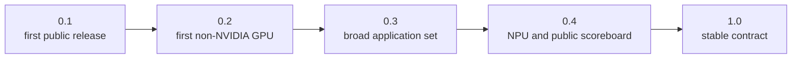

# Roadmap

**English** · [한국어](ROADMAP.ko.md)

The plan is organised as milestones. A milestone is reached when every exit measure in it is met and the result is published with sample output and median / slow-10 % speed. **No dates are promised.** Milestones are ordered, and work on a later one can start early when it does not depend on an earlier one.

## Where we are

Measured so far (details in [README.md](../../README.md)):

- llama.cpp (about 150 CUDA source files) builds unmodified, and its operator test passes 15,894 / 15,894 on the CPU path and on the NVIDIA GPU path.
- The BLAS-compatible library passes 1,395 / 1,395 cases on CPU and GPU, and the CUB subset passes 5,500 independent checks.
- Backends:
  - CPU (reference) and NVIDIA GPU work.
  - Apple GPU (Metal) is a first cut: backend tests 53 / 53, and the translator handles 49 of 79 Rodinia kernels.
  - OpenCL works on PoCL (103 / 103).
  - The NPU simulator is a design target.
- llama.cpp's greedy-token differences are floating-point ordering at near-ties, measured against a high-precision oracle by KL divergence.
- Check suites:
  - Linux 231 / 231
  - Windows (cross-built, Wine) 151 / 151
  - macOS 124 / 124
  - Windows 10 laptop 37 / 38, with 1 skipped

---

## 0.1 — First public release

Make what exists easy to install, check and cite.

| Item | Exit measure |
|---|---|
| Versioned release with a changelog | a tagged 0.1 release; every user-visible change listed |
| Public CI on Linux, macOS and Windows (cross-built) | every pull request runs the check suite; results visible on the repository |
| Install and package | `cmake --install` plus `find_package` work on all three systems; a smoke test runs from the installed tree |
| Reproducible results | every number in the README names its card, command and machine; `tools/scoreboard.py` regenerates the tables |
| Known limits documented | the FAQ lists every unsupported area; each returns "not supported" at run time |

## 0.2 — First results beyond NVIDIA

Show the layer on at least one real non-NVIDIA GPU, and make "the same answer" part of the suite.

| Item | Exit measure |
|---|---|
| llama.cpp on a non-NVIDIA GPU (Apple GPU, AMD or Intel) | builds unmodified; operator tests within tolerance; speed published next to that chip's native backend |
| AMD backend on the vendor's public runtime layers | backend levels B0 and B1 on real hardware |
| OpenCL on GPU drivers (beyond PoCL) | backend tests and Rodinia on at least one GPU OpenCL driver |
| Application level L5 by KL divergence | the oracle-based comparison runs in the suite for llama.cpp, with the threshold rule from the [logit study](../llama-cpp-logit-agreement.md) |
| Faster CPU reference path | matrix work sent to a fast CPU library; llama.cpp generation within 10x of its own CPU backend |

## 0.3 — A broad application set

Stop measuring mainly one program.

| Item | Exit measure |
|---|---|
| Benchmark collection (hundreds of CUDA programs) | build rate and pass rate published per program; failures grouped by missing feature |
| Training code base | forward and backward passes run unmodified; loss curve matches a reference within tolerance |
| Thrust-heavy library | builds and passes its own tests on the CPU path |
| Texture objects and the texture reference API | Rodinia programs that use textures translate and pass |
| Metal: double-precision policy, class templates, pointer-to-pointer arguments | Rodinia kernels on Apple GPUs at 70 of 79 or more |
| cuBLASLt-style matmul, Thrust on the CUB subset | each with its own L4 suite |

## 0.4 — NPUs and a public scoreboard

Bring accelerators without SIMT threads in, and let others submit results.

| Item | Exit measure |
|---|---|
| Operator table on a real NPU SDK | an LLM runs end to end through the operator table on at least one NPU; B3 reported without B2 |
| Operator table revision from real-SDK experience | changes go through an RFC; the NPU simulator follows |
| Public scoreboard | a documented path to submit result records, verify them, and publish them per chip and per implementation |
| FFT and random numbers | per-library L4 suites |

## 1.0 — A stable contract

Freeze what chip makers build against.

| Item | Exit measure |
|---|---|
| Stable backend ABI and operator table | a compatibility promise: 1.x backends keep working with later 1.x runtimes |
| Conformance levels L1 to L5 complete | every documented API call and language feature has a test; mutants show the tests catch seeded defects |
| Governance in practice | a steward and maintainers from more than one organisation, as described in [GOVERNANCE](GOVERNANCE.md) |
| Native MSVC build | the check suite passes with MSVC |

## Long-term

These need several libraries and a large part of the runtime, so they are reached step by step, each library with its own suite:

- neural-network primitives (cuDNN-level) and multi-device communication (NCCL-level), towards PyTorch;
- CUDA graphs and peer-to-peer memory across devices;
- more architectures, such as RISC-V.

## How the plan changes

Roadmap changes go through the pull-request process. Items that change the backend interface or the operator table need an RFC ([GOVERNANCE](GOVERNANCE.md)). When a milestone is reached, this page records the release and moves the measured results into "Where we are".
